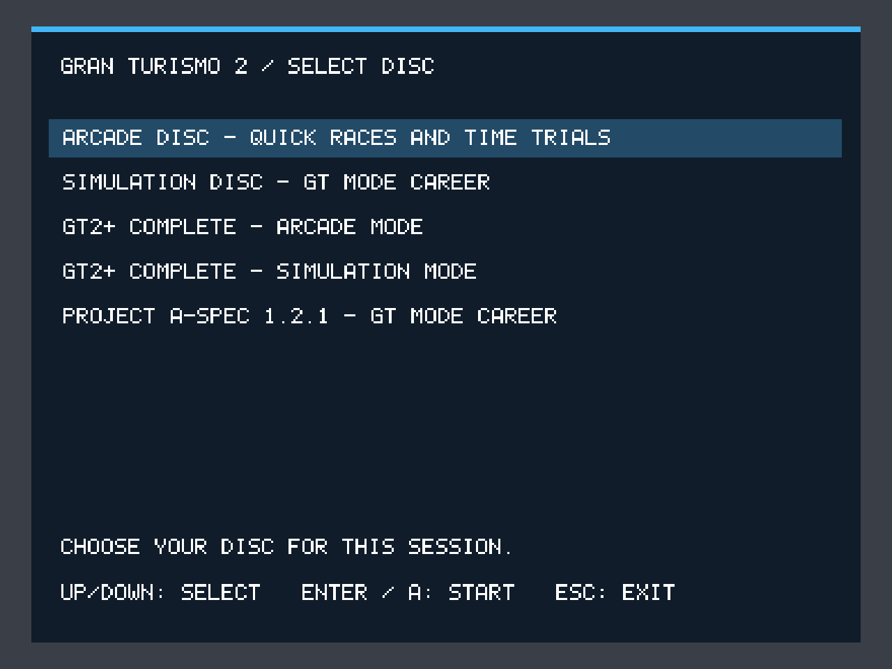

# Modified disc images

The game reads these mods directly from their disc images. It does not patch, copy or redistribute them, and no
mod files are bundled.

## Supported images

| Image | How it is recognised |
|---|---|
| A-Spec 1.x, Simulation disc | Its executable is the retail US Simulation v1.2 build (`3030aa27…`), so it loads as that build. Verified with 1.2.1. |
| A-Spec 1.x, Combined disc | The Simulation executable carries the combined-disc marker in `GT2.OVL` member 1; the existing combined-disc path accepts it. Verified with 1.2.1. |
| GT2+ Complete, NTSC-U Simulation v1.2 beta 7 | Registered executable SHA-1 `9d733c40…` (see `KnownMods` in `src/gt2formats/exe_profile.cpp`). |
| GT2+ Complete, NTSC-U Arcade v1.1 beta 7 | Registered executable SHA-1 `85aa2586…`; its Arcade v1.1 base has its own profile (`23803938…`, `db/arcade_us11_rev1_symbols.yaml`). |
| GT2+ Complete, other regions/versions | Apply the mod's own xdelta to a clean disc, then run `gt2install inspect`; if the executable is not registered, add its SHA-1 as below. |
| US Arcade v1.0 (`231f9dba…`) and v1.1 (`23803938…`) | Both load; v1.1 is the GT2+ Arcade base. |
| Retail US/EU Simulation | Unchanged. |

A-Spec keeps the retail executable on its Simulation discs, so older A-Spec releases of the same data-only
pipeline load the same way. If one of them is refused, `gt2install inspect` prints its SHA-1; add that hash to the
registry (one line) rather than changing the loader.

## What the mods change

- A-Spec ships no game code: executable identical to retail, only assets, car data, events, music and menu data
  (plus one event-name table in the GT menu overlay). Everything appears through the normal data readers.
- GT2+ Complete changes 11 bytes of the executable (turbo-section check and the two save-file ID strings) and a few
  bytes of display code. Its data changes are read normally.

The mod also changes two executable behaviours: a turbo-section check and metric horsepower. Image support does
not depend on them. A behaviour a mod changes is keyed to that mod's executable and never applied to every disc:
both follow the disc by default (`AUTO`), so a GT2+ file gets the stock-turbo Turbo section and PS power figures
while retail and A-Spec keep the stock menu and hp. The F10 menu overrides each one: **Options and cheats → Turbo
section fix** (`AUTO` / `ON` / `OFF`) and **HUD elements → Power units** (`AUTO` / `hp` / `PS`). Power figures stay
display-only; simulation and saves remain in PS. The title PC SETTINGS Power Units row offers the same three values.

GT2+'s separate save file works through the executable's own card names: saves and replays are read and written as
`BASCUS-94455GAME7C` / `BASCUS-94455REPL7C`, so vanilla and GT2+ saves coexist on one memory card. An existing
vanilla save is never renamed or modified; a GT2+ game creates or updates only its own file. The two careers are
separate by design (GT2+ saves are not compatible with vanilla), so switch discs to switch saves.

## Saves, installs and modified data

A career stores car ids and setups, not car names or power figures. Two images whose car tables
(`.carcolor`, `.carinfoa`, `.carinfoe`, `.carinfoj`) differ therefore read the same save as different cars and
horsepower, which is why a retail save opened in A-Spec looks wrong. The four tables' SHA-1 names the **dataset**, and
the dataset decides where saves and installs live:

| Dataset | Install folder | Memory card and settings |
|---|---|---|
| Retail US Simulation / Combined v1.2 (`be0dc795…`) | `simulation`, `combined` | `saves/simulation/card1.mcd`, `saves/simulation/settings.txt` |
| Project A-Spec 1.2.1 (`03092e33…`) | `simulation-aspec`, `combined-aspec` | `saves/simulation-aspec/card1.mcd`, shared `saves/simulation/settings.txt` |
| GT2+ Complete beta 7 (`3e100467…`) | `simulation-plus`, `combined-plus` | `saves/simulation-plus/card1.mcd`, shared `saves/simulation/settings.txt` |
| Any other data set | `<mode>-<first 8 hex digits>` | its own folder; settings stay per mode |

- Silent's combined disc copies the Simulation volume's car tables unchanged, so a combined and a standalone disc of
  the same mod share one card (`simulation-aspec`), while the arcade flow of a combined disc uses `arcade-aspec`.
- The retail Arcade discs (v1.0 and v1.1) keep the plain `arcade` install and save folder; GT2+ Arcade uses
  `arcade-plus` because its car tables are the GT2+ dataset.
- A new mod needs no code change to keep its saves apart: its unrecognised dataset gets a hash suffix. Register its
  fingerprint in `src/gt2formats/dataset.cpp` (one line) to give it a readable name and label.
- Each installed dataset is its own entry in the disc picker, so the retail disc, A-Spec and GT2+ can be installed
  side by side. Installing one never replaces another.


- Install folders made before this layout have no `disc.json`: they keep their old names and the original
  `saves/<mode>` folders. Re-import the image once to move it to a suffixed entry; the old save card is left in place
  and is not renamed or deleted.
- GT2+ saves made before this layout are in the shared `saves/simulation/card1.mcd`. Copy that card to
  `saves/simulation-plus/` (a copy, not a move) to keep using them from the GT2+ entry.

## Checking an image

```
gt2install inspect /path/to/disc.bin
```

The JSON reports `mode`, `combined`, the image's `exeSha1`, the matched `profile`, the asset count, the card file
names (`save` / `replay`), the registered `mod` name, and the dataset `suffix`, install `folder` and display `label`.
An unknown executable is refused with its SHA-1.

## Adding another modified build

Only do this for a build that keeps a stock layout (no moved code or data tables). In practice the mods above patch
code in place.

1. `gt2install inspect` the image and copy `exeSha1`.
2. In `src/gt2formats/exe_profile.cpp`, add `{ "<sha1>", "<name>", &kProfiles[<base>] }` to `kKnownMods`.
3. In `scripts/gt2_disc.py`, add `"<sha1>": "simulation"` (or `"arcade"`) to `MODS` so the Python installers accept it.

## Limitations

- The GT2+ Arcade xdelta targets US Arcade **v1.1** (`23803938…`); it refuses the v1.0 disc (`231f9dba…`) with a
  target-window checksum mismatch. Both clean Arcade revisions run.
- Modified executables do not use HD media prepared for the clean build (the profile stamp differs); original disc
  assets are used instead.
- Only the data the port reads is supported. Code-only mod features are not emulated; for these mods that is not a
  loss (A-Spec has none; GT2+ has the two behaviours listed above).
- A-Spec's sparse car-colour table and unsorted solo data are tolerated; the affected car-colour entries show no
  colour name instead of failing the whole menu.
